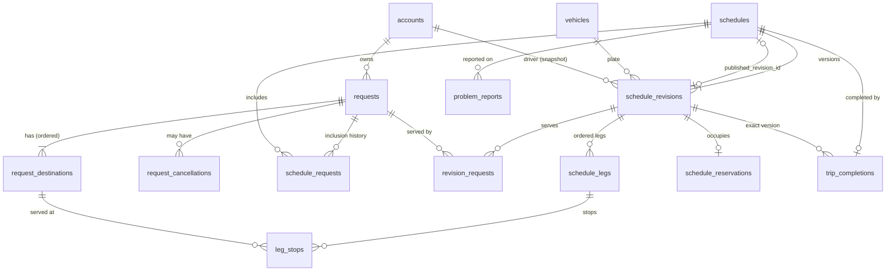

# KOVA v2.0 — Phase 3: database model, permissions and state transitions

Branch `feat/v2-foundation`. Everything here was applied and tested on the
**local Docker database only** — nothing has been applied to the shared
`kc-kova` Supabase project (see `docs/MEMORY.md`, "Phase 3 design
decisions").

Decisions this phase is built on (all in `docs/MEMORY.md`):

- v2 reservations are a new table with minute-precision time ranges and
  Postgres exclusion constraints; legacy `bookings`/`booking_slots` are kept
  unchanged for history.
- Role values are capitalized: `Requester`, `Scheduler`, `Admin`, `Driver`.
  `Booker` is removed completely, not kept as an alias.

## 1. Migration manifest

| # | File | What it does | Safe while v1.2 is live? |
|---|---|---|---|
| 0013 | `v2_roles_expand` | Allows `Requester` and `Scheduler` next to `Booker`; adds `current_account_role()` | Yes — only widens |
| 0014 | `v2_requests` | `requests`, `request_destinations`, `request_cancellations` + RLS | Yes — new tables |
| 0015 | `v2_schedules` | `schedules`, `schedule_revisions`, `revision_requests`, `schedule_requests`, `schedule_legs`, `leg_stops`, `schedule_reservations`, closed-version guard, visibility helpers + RLS | Yes — new tables |
| 0016 | `v2_rename_vehicle` | `rename_vehicle` also moves v2 revisions/reservations to the new plate | Yes — same signature and behavior for v1 tables |
| 0017 | `v2_completion` | `trip_completions`, `problem_reports`, Done lock + RLS | Yes — new tables |
| 0018 | `v2_audit_history` | Append-only `audit_events` + triggers on every v2 table | Yes — new table |
| 0019 | `v2_request_rpcs` | `create_request`, `update_request` | Yes — new functions |
| 0020 | `v2_revoke_default_grants` | Removes the template's default write/TRUNCATE grants on v2 tables | Yes |
| 0021 | `v2_schedule_rpcs` | `save_schedule_draft`, `submit_schedule`, `approve_schedule`, `return_schedule`, `discard_schedule_draft` | Yes — new functions |
| 0022 | `v2_request_progress` | Derived `request_progress` view | Yes — new view |
| 0023 | `v2_roles_convert` | Converts `Booker` → `Requester`, drops `Booker` from the constraint, updates the two legacy role checks | **No — release-time only** |

0013–0022 are the "expand" step: additive, and v1.2 keeps working with
them applied. 0023 is the "migrate + contract" step and must run together
with the v2 application at cutover (§7). Nothing here drops or rewrites a
legacy table.

## 2. Schema



How the conceptual records in the plan map to tables:

| Plan record | Table(s) |
|---|---|
| Request | `requests` (owner id + name snapshot, date, Regular/Urgent, project option or Other text, state, timestamps) |
| Request destination | `request_destinations` (destination id/name snapshot, purpose id/name snapshot, original order). Edits deactivate old rows instead of deleting them. |
| Schedule | `schedules` (date, Scheduler creator, lifecycle, published version) |
| Schedule revision | `schedule_revisions` (version, vehicle, Driver snapshot, approval state and details) |
| Request inclusion | `schedule_requests` (active/released, never deleted) + `revision_requests` (which requests each version serves) |
| Leg/request mapping | `schedule_legs` + `leg_stops` — a shared stop is one leg with several stops, each keeping its own requester and purpose |
| Reservation | `schedule_reservations` — one time range per live version, per vehicle and Driver |
| Completion | `trip_completions` (exact approved version, Driver, one odometer pair, server `submitted_at`, SUBMITTED/DONE) |
| Problem report | `problem_reports` |
| Audit history | `audit_events` (actor, role at the time, action, table, record, reason, before/after) |

## 3. State and transition rules

States that change for different reasons are stored separately and are
never merged into one field.

**Request** (`requests.status`): `ACTIVE` → `CANCELLED`. Progress is
**derived**, never stored (`request_progress` view):
`NOT_YET_SCHEDULED` → `SCHEDULING` → `PENDING_APPROVAL` → `APPROVED` →
`COMPLETED` → `DONE`, or `CANCELLED`. A pending cancellation is a separate
flag (`cancellation_pending`). The request keeps its real progress until an
Admin confirms the cancellation.

**Schedule** (`schedules.status`): `ACTIVE`, `DISCARDED` (draft thrown away
before it was ever approved), `CANCELLED` (Phase 7).

**Schedule revision** (`schedule_revisions.status`):

| From | Action (RPC) | Who | To |
|---|---|---|---|
| — | `save_schedule_draft` with no schedule id | Scheduler only | `DRAFT` v1 |
| `DRAFT` / `RETURNED` | `save_schedule_draft` | Scheduler | `DRAFT` |
| `SUBMITTED` | `save_schedule_draft` (review edit) | Admin | `SUBMITTED` |
| approved, no open version | `save_schedule_draft` | Scheduler | new `DRAFT` v(n+1) (proposal) |
| `DRAFT` / `RETURNED` | `submit_schedule` | Scheduler | `SUBMITTED` |
| `SUBMITTED` | `return_schedule` (comment required) | Admin | `RETURNED` |
| `SUBMITTED` | `approve_schedule` | Admin | `APPROVED`; the previous approved version → `SUPERSEDED` |
| `DRAFT` / `RETURNED` | `discard_schedule_draft` | Scheduler | `DISCARDED` |

Rules the database enforces:

- **Only a Scheduler creates schedules.** Admin calling
  `save_schedule_draft` without a schedule id gets `42501`. Admin can
  change only a version that has been submitted to them.
- At most one open version (`DRAFT`/`SUBMITTED`/`RETURNED`) and one
  `APPROVED` version per schedule (partial unique indexes).
- Closed versions (`APPROVED`/`SUPERSEDED`/`DISCARDED`) are immutable: a
  trigger rejects any change to their legs, stops or request list, even
  from the service role.
- Approval rechecks that the version is complete, the Driver and vehicle
  are still active, no included request has a pending cancellation, and no
  completion has been submitted. It then swaps the old reservation for the
  new one in the same transaction, so a failed approval changes nothing.
- A submitted completion blocks every further save and approval.
- A version is complete when it has at least one request, ends with the
  one final leg back to ANONANG, and puts every destination of every
  included request on exactly one leg.
- Route: leg 1 starts at ANONANG and every later origin is the previous
  destination — the server derives origins and ignores any sent by the
  client. Planned times are `HH:MM`. Time In must be after Time Out, and
  each leg leaves no earlier than the previous one arrives.

**Inclusion and locking**: a request is held by a schedule while it
appears in that schedule's published or open version. While held, its
owner can't edit it and no other schedule can include it. Discarding a
draft, or approving a version that dropped the request, releases the
inclusion: the request returns to `NOT_YET_SCHEDULED` and is unlocked.
Releases set `released_at`; rows are never deleted.

**Reservations**: every live version (open or approved) holds one range
from its first Time Out to its last Time In, Asia/Manila time, at minute
precision. Two different schedules can't overlap on the same vehicle or
the same Driver (exclusion constraints). A pending proposal and the
version it would replace don't count as conflicting with each other.

**Completion**: `SUBMITTED` → `DONE`. A trigger locks DONE records against
any change, including from the service role.

## 4. Permission matrix

Reads are row-level security on each table. Writes are **only** through
the RPCs: `authenticated` has `SELECT` and nothing else on every v2 table,
and `anon` has no access at all.

| Table / view | Requester | Scheduler | Admin | Driver |
|---|---|---|---|---|
| `requests`, `request_destinations` | own | all | all | only those on their published schedules |
| `request_progress` | own | all | all | only those on their published schedules |
| `request_cancellations` | own | — | all | — |
| `schedules`, `schedule_revisions`, `schedule_legs` | published version of schedules serving their requests | all, incl. drafts | all | published version of their own schedules |
| `leg_stops`, `revision_requests` | their own stops only | all | all | their published schedules |
| `schedule_requests` | own requests | all | all | their published schedules |
| `schedule_reservations` | — | all | all | — |
| `trip_completions` | — | — | all | own |
| `problem_reports` | — | all | all | own |
| `audit_events` | — | — | all | — |

Requesters who share a schedule never see each other's requests, stops or
purposes. They see the route itself (legs), but only once it is published.

| RPC | Requester | Scheduler | Admin | Driver |
|---|---|---|---|---|
| `create_request` | ✓ (date rules) | — | ✓ (past dates allowed) | — |
| `update_request` | own, unscheduled | — | own, unscheduled | — |
| `save_schedule_draft` (create) | — | ✓ | **—** | — |
| `save_schedule_draft` (edit) | — | DRAFT/RETURNED/new proposal | SUBMITTED only | — |
| `submit_schedule`, `discard_schedule_draft` | — | ✓ | — | — |
| `approve_schedule`, `return_schedule` | — | — | ✓ | — |

Request date rules (Asia/Manila calendar days, checked on the server):
Regular requests must be at least 7 days ahead; Urgent requests must be
for today or tomorrow; 2–6 days ahead is refused for both types. Admin may
also request a past date.

## 5. Concurrency

| Race | Guarantee | Mechanism |
|---|---|---|
| Two schedules include the same request | One wins | Request row `FOR UPDATE` + unique active inclusion |
| Overlapping vehicle/Driver time | One wins | Exclusion constraints on `schedule_reservations` |
| Owner edits while a Scheduler includes (either order) | Never both | Both lock the request row first |
| Two people save the same draft | Second gets `40001` | `row_version` compare under schedule row lock |
| Two Admins approve at once | One wins | Schedule row `FOR UPDATE` + state recheck |
| Approval vs. completion submission | Serialized | Both lock the schedule row (completion RPC arrives in Phase 8) |

Locks are always taken in the same order (schedule row, then its open
revision, then requests sorted by id), so concurrent RPCs can't deadlock
each other.

## 6. Requester role migration

Inventory, taken from `docs/v2/baseline.md` §7 and updated this phase:

- **Database**: `accounts_role_check` (0013 widens, 0023 contracts); the
  only legacy role checks naming Booker were `create_booking` and the
  `bookings_select` policy — both switched to `Requester` in 0023. Every v2
  function accepts only the four v2 roles.
- **Auth claims**: none. KOVA never puts the role in the auth token or
  `user_metadata`. `requireAccount()` (`lib/supabase/session.ts`) reads
  `accounts.role` on every request, so there are no stale claims to
  invalidate and **nobody has to sign in again**. A browser tab left open
  may show the old menu until reload, but every action is rechecked on
  the server.
- **API validators**: `app/api/accounts/**` accept only the four v2 roles.
  `app/api/records/[recordId]` now allows only Driver and Admin, where it
  previously blocked only Booker, so Scheduler is excluded too.
- **Frontend and types**: `Role` in `lib/kova-api.ts`, `app/page.tsx`,
  `app/scheduler.tsx`, `app/settings.tsx`. Scheduler gets a placeholder
  home with no actions until Phase 5 builds its screens.
- **Tests**: unit fixtures renamed. pgTAP checks that `Booker` is rejected.
- **History**: `audit_events.actor_role` records the role at the time and
  is never rewritten.

Local rehearsal of 0023: a seeded Booker account that owned a legacy
booking kept its id, became `Requester`, and still owned and could see the
booking. It passed the `create_request` role check, and afterwards the
database refused `Booker` as a role value.

## 7. Release order and rollback

At cutover (Phase 11, with separate release approval):

1. 0013–0022 can be applied ahead of cutover while v1.2 is still live —
   they only add things.
2. Pause writes → take the backup → deploy the v2 application → apply 0023
   and 0032 → verify sign-in and role access → resume writes. 0032 (Phase 9b)
   drops the v1.2 booking tables and functions the live v1.2 app still
   uses, so it can't go ahead of cutover with the additive ones.

A Vercel rollback restores **code only**. After 0023, v1.2 code can't
serve converted accounts, and after 0032 the v1.2 tables are gone, so going
back to v1.2 also needs a restore from the pre-cutover backup. To go back
after cutover, pause writes and reverse the conversion. **Rehearse this locally first**:

```sql
alter table accounts drop constraint accounts_role_check;
alter table accounts add constraint accounts_role_check
  check (role in ('Booker', 'Requester', 'Scheduler', 'Driver', 'Admin'));
update accounts set role = 'Booker' where role = 'Requester';
update accounts set status = 'Inactive' where role = 'Scheduler'; -- no v1.2 equivalent
-- then re-run the bookings_select policy and create_booking definitions
-- from 0007/0012 (Booker checks) as a new forward migration.
```

The v2 tables stay in place (harmless to v1.2). Any v2-only records
written before the rollback must be reconciled first, not dropped.

## 8. Tests and evidence

Run locally only:

```sh
supabase db reset --local                 # replays 0001–0023 from scratch
supabase test db                          # pgTAP: supabase/tests/*.test.sql
bash supabase/tests/concurrency.sh        # two real sessions racing
```

Results on a fresh reset (2026-09-24):

- pgTAP: **72/72** — `v2_requests.test.sql` (24), `v2_schedules.test.sql`
  (48). These cover role gates including Admin being unable to create a
  schedule, date rules, snapshots, stale edits, the edit lock, per-role
  row visibility, direct-write denial, shared stops, reservation
  collisions, the submit/return/approve/revision lifecycle, draft discard,
  closed-version immutability, derived progress, the completion lock,
  plate renames, audit history and the retired Booker role.
- Concurrency: **9/9** — five races (include/include, overlapping
  reservation, edit-then-include, include-then-edit, approve/approve),
  each with exactly one winner and the expected error for the loser, plus
  four invariant checks.
- App gates: `tsc` clean, `lint` 0 errors (2 existing `` warnings),
  `vitest` 63/63, `next build` passes.

## 9. Deferred to later phases (deliberately not in Phase 3)

- Cancellation RPCs, including confirm/decline and schedule cancel —
  Phase 7. The table exists, and approval already respects pending
  cancellations.
- Completion and problem-report RPCs — Phase 8. The tables, locks and RLS
  exist.
- Admin starting a revision of an **approved** schedule — Phase 6 decides
  whether Admin may start one directly; today only a Scheduler can.
- Legacy v1.2 `booking_slots` and v2 `schedule_reservations` never checked
  each other for conflicts. There is no legacy data to carry over, so
  migration 0032 (Phase 9b) drops the v1.2 tables instead of reconciling
  them.
- The old booking UI and RPCs were removed in Phase 9b, once the Phase 4-9
  screens had replaced them.
- **Found, not fixed (v1.2 scope)**: locally, the Supabase template grants
  `anon`/`authenticated` every table privilege, including `TRUNCATE`, on
  the v1.2 tables too. PostgREST doesn't expose `TRUNCATE`, so this isn't
  reachable from clients today. 0020 closes it for v2 tables only.
  Whether the hosted project has the same grants is unverified.
